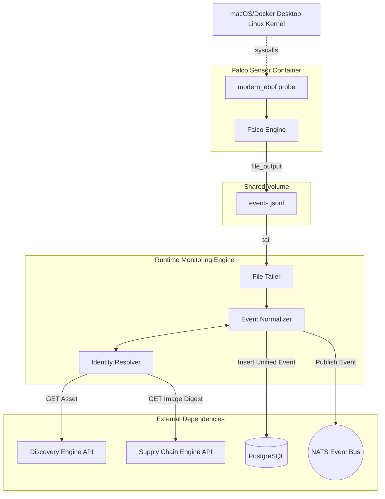

# Phase 5 Runtime Monitoring Architecture

This document describes the ZERAXIS Phase 5 Runtime Monitoring Engine (Stage 1).

## Architecture

The Runtime Engine acts as an independent, unprivileged telemetry normalizer that consumes raw kernel observations from Falco, resolves application container identities via the Discovery Engine, and persists unified events.

## Falco Role and Privileges

Falco acts strictly as a read-only sensor observing the Linux kernel via modern eBPF.
It generates raw JSON telemetry when syscalls match defined security rules.

**Privileges & Mounts:**
- `pid: host`: Required to trace process hierarchy correctly.
- Capabilities: `SYS_ADMIN`, `BPF`, `PERFMON`, `SYS_RESOURCE`, `SYS_PTRACE`.
- No `privileged: true`.
- No Docker socket (`/var/run/docker.sock`). Container IDs are derived purely from cgroup tracing.
- Read-only mounts: `/proc` and `/sys/kernel/debug`.

## Runtime Engine Role

The Runtime Engine consumes raw Falco JSON telemetry via a shared file (`/var/run/falco/events.jsonl`).
It is 100% unprivileged. It requires no Docker socket, no host mounts, and no Linux capabilities.

## Identity Resolution

Falco only knows the 12-character container ID (e.g. `3b56eed5bd81`) derived from cgroups.
It does not know the ZERAXIS Asset ID or the immutable image digest.

The Runtime Engine queries the Discovery Engine (`/api/v1/assets`) and Supply Chain Engine (`/api/v1/assets/{id}/supply-chain`) to resolve the short container ID into the canonical UUID `asset_id` and the immutable `image_digest`.

## Event Types

Stage 1 supports:
1. `PROCESS_EXECUTION` (execve)
2. `NETWORK_CONNECTION` (connect/accept)
3. `FILE_ACTIVITY` (open/openat for writes)

## Failure Behavior & Known Limitations

- **Discovery Race Condition**: If a container starts and immediately performs an action, Discovery may not have scanned it yet. The Runtime Engine will retry resolution with exponential backoff for up to 60 seconds.
- **Lost Telemetry**: If resolution fails after 60 seconds, the event is permanently dropped to avoid fabricating un-correlated data.
- **Durable Persistence**: Events are written to PostgreSQL first. If NATS fails, the event remains durably stored. If PostgreSQL fails, NATS publication is aborted.
- **Pure Observation**: Runtime Monitoring only observes behavior. It does not determine maliciousness, kill processes, or isolate networks.
