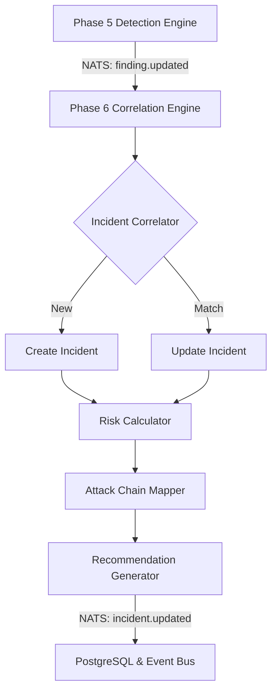

# ZERAXIS Phase 6 Architecture

## Overview
Phase 6 introduces the Correlation and Risk Engine (`engines/correlation`), a dedicated microservice that bridges the gap between individual Findings (Phase 5) and holistic Security Incidents. It assesses risk, correlates attack chains, and generates human-actionable recommendations.

## Core Components
1. **Correlation Engine**: Consumes Findings from `zeraxis.events.detection.finding.>` and groups them into Incidents based on deterministic temporal and topological overlapping criteria (`asset_id`, `image_digest`, timeframe).
2. **Risk Engine**: Evaluates a combined score (Static + Dynamic) capped at 100, incorporating CVE severity, asset criticality, and behavioral confidence.
3. **Attack Chain Modeler**: Maps incident findings to deterministic stages (Exposure, Execution, Network) using strict evidence bounds (Observed vs Inferred).
4. **Recommendation Engine**: Generates non-executing JSON proposals for mitigating the active risk (e.g., "Quarantine Asset").

## Data Flow

## Security & Failure Boundaries
- **No Docker Socket**: The Correlation engine strictly operates on NATS payloads and DB reads.
- **Fail-Safe Processing**: If Supply Chain DB is offline, Static Risk defaults to a fallback model while Dynamic Risk remains accurate.
- **Strict Deduplication**: Incidents employ rolling sliding windows to prevent DB explosion during finding floods.

## Phase 7 Boundary
Phase 6 STOPS at the Recommendation layer. It will not mutate the cluster. Phase 7 will later subscribe to the Recommendation stream to act upon it.
