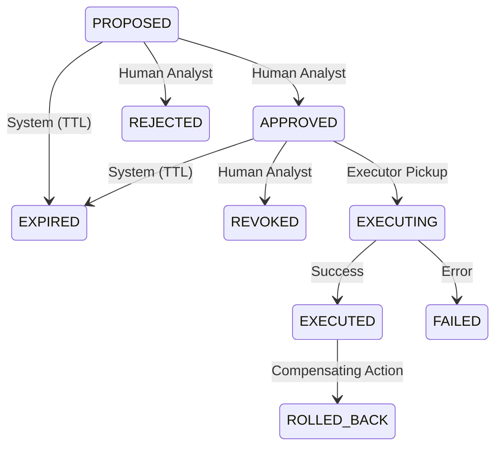

# Phase 7.1: Authorization Model

## State Machine

## Approval Requirements
1. **Who can approve?** Only an authenticated Human Analyst with explicit `EXECUTE` RBAC permissions (future expansion).
2. **What constitutes approval?** A cryptographic or structured database insert recording `approver_id`, `approved_at`, and `approval_reason` linking to a valid `recommendation_id`.
3. **Double approval?** No. Idempotent key constraints will prevent double-approval.
4. **Revocation?** Yes, an analyst can revoke approval IF state == `APPROVED` (not yet `EXECUTING`).
5. **Expired Execution?** A recommendation that has exceeded its TTL (e.g., 24h) cannot be executed. The Executor will re-validate age on pickup.
6. **Resolved Incidents?** If the parent incident resolves, any pending recommendations must instantly expire/revoke.
7. **Identity Shift?** If the target container or image digest changes between proposal and execution, execution MUST ABORT.
